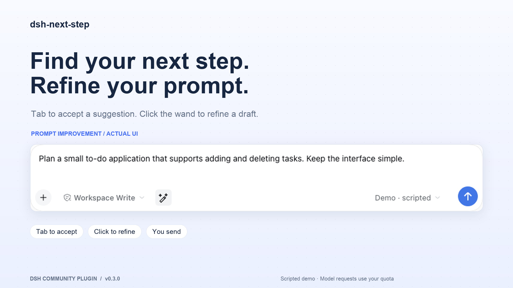
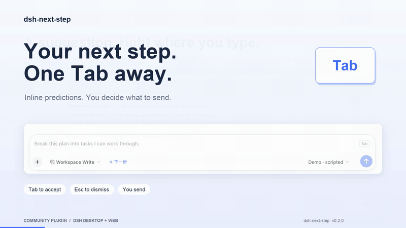
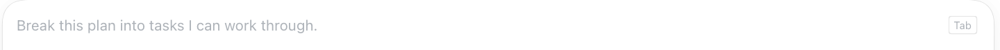
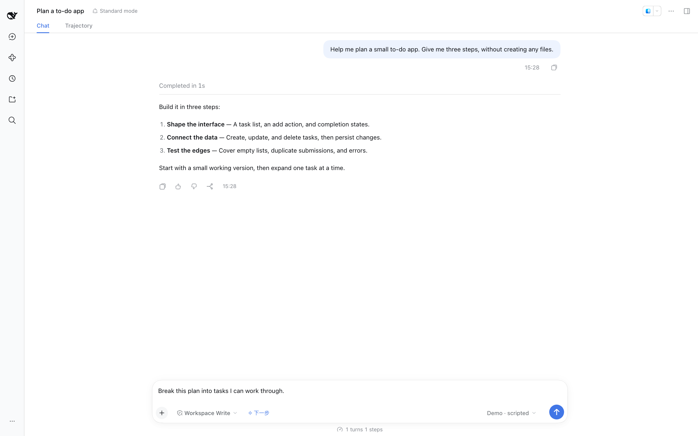

# dsh-next-step

**Find your next step. Refine your prompt.**

[简体中文](README.zh-CN.md) · [Download](https://github.com/Tieboyh/dsh-next-step/releases/latest) · [English video](media/en/promo-en.mp4) · [中文视频](media/zh/promo-zh.mp4)



A community plugin for **DeepSeek Harness desktop and web**. After a reply finishes, a suggested next message appears in gray inside the composer. Press **Tab** to turn it into an editable draft. Have a draft already? Click the magic-wand icon to refine it, then review and send when ready.

## See it work

[](https://github.com/Tieboyh/dsh-next-step/releases/download/v0.3.0/promo-en.mp4)

- **Inline suggestions:** same composer, same font, no extra suggestion panel.
- **One-click prompt improvement:** write a draft, then click the magic-wand icon to turn it into a well-described, actionable spec. Known requirements stay explicit; missing details appear under **To confirm**, without invented requirements. Review and edit before sending.
- **Tab to accept:** the prediction becomes a normal draft. It does not send itself.
- **Esc to dismiss:** keep writing your own message.
- **Your draft comes first:** typing, attachments, queued messages, and a new turn hide the prediction.
- **Plugin-controlled:** predictions are active whenever the plugin is enabled. To turn them off, disable the plugin in DSH’s plugin manager.
- **Existing model setup:** uses DSH's configured provider and credentials. No separate API key to enter.


| Prediction text detail | Accepted text detail |
| --- | --- |
|  |  |


The improvement screen comes from v0.3.0 verification. Prediction text details are crops of an earlier demo; the old toggle is excluded. [Media sources](docs/MEDIA.md) · [All assets](media/)

## Install

No build step or runtime npm dependencies are required.

1. Download the [source archive](https://github.com/Tieboyh/dsh-next-step/archive/refs/tags/v0.4.1.zip) and extract it.
2. Add the extracted plugin directory in DSH’s **Plugin Manager**.
3. Enable **dsh-next-step** there. Use the same manager to disable it.

Both features follow the plugin state, with no separate composer toggle. Reload an updated local installation through Plugin Manager; no separate startup entry point is needed.

## Improve a draft

The optimizer turns a brief into a compact specification that can be given directly to an AI or developer. It organizes the goal, known requirements, scope, constraints, behavior, and acceptance criteria when the draft supports those sections. Empty boilerplate is omitted. Acceptance checks must follow from stated requirements; missing scope or acceptance criteria become questions, not invented defaults. When missing details materially affect execution, it lists specific questions under **To confirm** and asks the recipient to resolve them before making dependent decisions. It does not choose an unrequested framework, style, feature set, deadline, or budget. Complete requests stay concise without an unnecessary question list.

For example, “Build a website with a distinctive style” becomes a request to design and build that website, with its purpose, audience, style references, and page/function scope listed as questions to confirm—not as assumed requirements.

The button displays a working label while a request is pending. Completion reports either that the draft was improved or that the model suggested no changes. Identical output leaves the draft and its revision untouched.

Click the magic-wand icon beside the composer controls. The request uses your configured model and sends only the current draft. The result replaces the draft without sending it. If you edit, send, switch sessions, or disable the plugin while a request is pending, its result cannot overwrite your new text. Errors preserve the original draft.

Failures explain whether the cause is a timeout, missing model, authentication, exhausted quota, rate limiting, network/service errors, or invalid/truncated output. DSH terminal stream failures keep their original error category. Only safe error categories and HTTP status codes are displayed; provider response bodies and credentials are never forwarded. Cancelling by editing or switching sessions stays silent. The plugin adds no retries or extra model requests.

The icon is disabled for empty drafts, drafts over 12,000 characters, active turns, and drafts containing structured file/session reference chips. Separate attachments are retained. Each click makes an additional model request and uses the service’s normal quota or billing.

## Keyboard

| Key | Action |
| --- | --- |
| Tab | Accept the visible prediction as a draft |
| Esc | Dismiss the current prediction |
| Shift + Tab | Keep normal keyboard focus navigation |

Predictions appear only when the session is idle and the draft, attachment list, and message queue are empty. IME composition does not trigger acceptance. Gray text is a display layer; it is not inserted into the editor document until accepted.

## Model calls and data

Generating a prediction makes an **additional request to your configured model service** and consumes that service's normal quota or billing. This plugin does not make inference local or free.

The request contains up to 10 recent user/assistant text messages, capped at 12,000 characters. Reasoning blocks, tool results, and attachments are excluded. Predictions and the auxiliary prompt are not appended to the conversation transcript. Results are cached per completed turn in host memory; a restart clears the cache. Errors, timeouts, and unsuitable results leave the composer unchanged.

## Configuration

By default, the plugin reuses the current session's provider and model, with the model's default reasoning configuration. To choose another already-configured route, add this entry to your profile's `cordis.patch.yml`:

```yaml
- id: next-step
  config:
    timeoutMs: 25000
    # provider: your-configured-provider-id
    # model: your-model-id
    # reasoningEffort: a-supported-effort-id
```

Set `provider` and `model` together. Timeout range: 1–60 seconds. Output cap: 512 tokens; accepted suggestions: at most 280 characters. No tools or agent actions run during prediction.

## Compatibility and development

Verified with **macOS DSH desktop 0.2.1-rc.2**. The media demo uses the matching DSH web runtime. Other versions may change plugin APIs.

```sh
npm run build  # JavaScript syntax checks
npm test       # 31 behavior tests
npm pack
```

- `index.js`: authenticated Connection Fetch RPC, shared by desktop IPC and web HTTP.
- `engine.js`: context selection, model call, deduplication, and invalidation.
- `client.js`: native DSH client module, composer ghost text, and prompt-improvement icon.
- `optimizer.js`: draft-only rewriting, cancellation, and output validation.

The screenshots and videos use the **actual DSH frontend and this plugin**, with a scripted demo provider and synthetic conversations. They are not evidence of live-model prediction quality. See [media provenance](docs/MEDIA.md).

[English launch copy](docs/PROMO.en.md) · [中文宣传文案](docs/PROMO.zh-CN.md)

MIT. Community project; not an official DeepSeek or OpenAI product.
