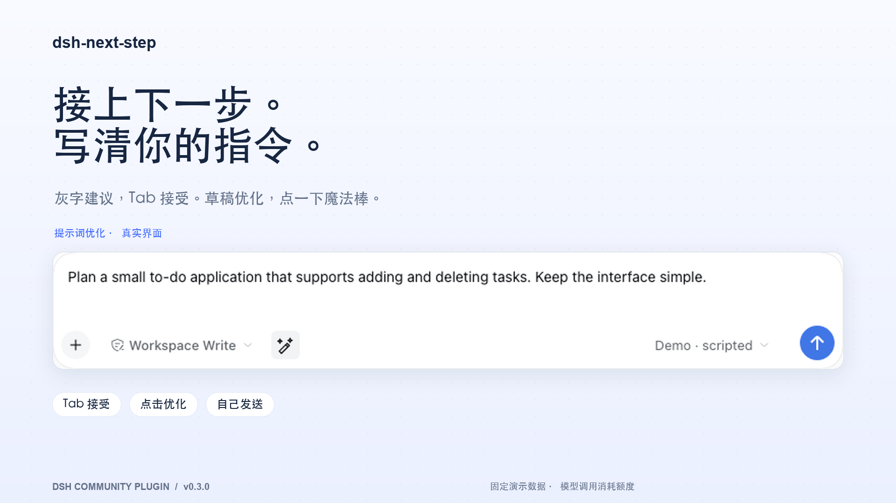
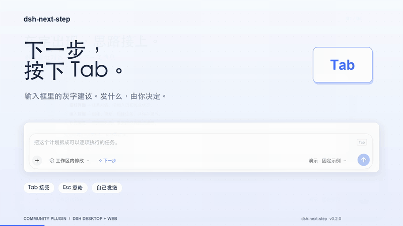
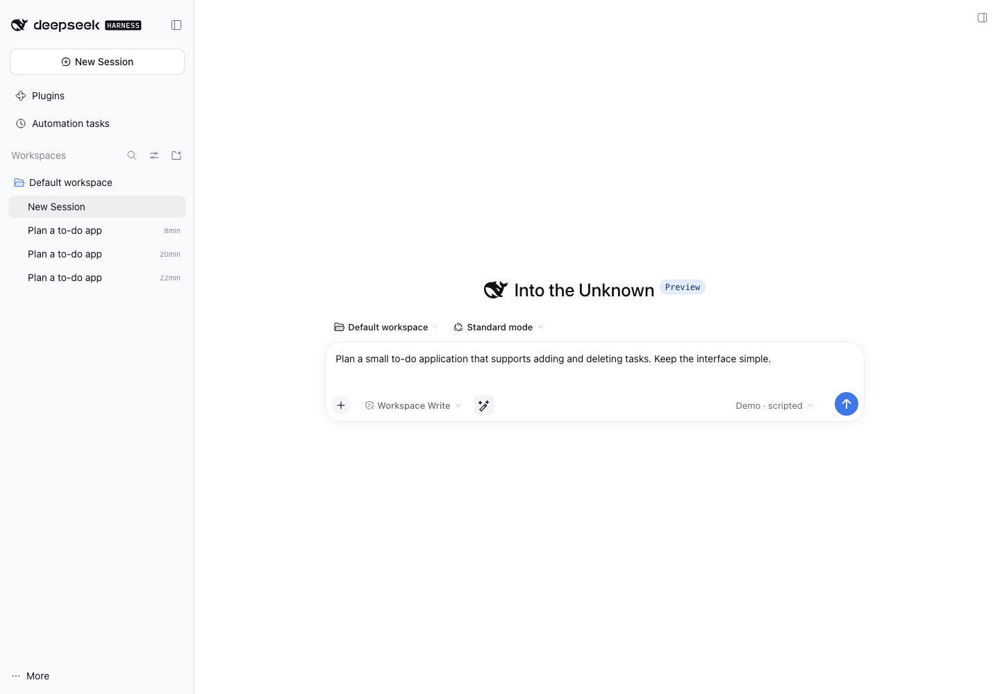
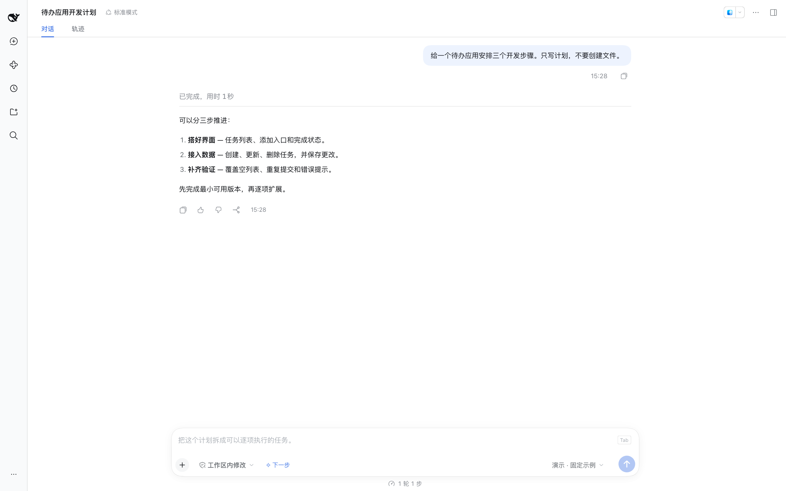

# dsh-next-step

**接上下一步。写清你的指令。**

[English](README.md) · [下载安装包](https://github.com/Tieboyh/dsh-next-step/releases/latest) · [中文宣传视频](media/zh/promo-zh.mp4) · [English video](media/en/promo-en.mp4)



为 **DeepSeek Harness 桌面端和 Web 端**制作的社区插件。回复结束后，下一条消息的建议会以灰字出现在输入框里。按 **Tab** 变成可编辑草稿，再由你决定是否发送。已有草稿时，点击魔法棒图标优化提示词，检查后再发送。

## 看看实际交互

[](https://github.com/Tieboyh/dsh-next-step/releases/download/v0.3.0/promo-zh.mp4)

- **建议就在输入框里**：沿用原生字体和行高，不额外占一块面板。
- **一键优化提示词**：写好草稿后，点击魔法棒图标生成描述清楚、可直接执行的需求规格（spec），保留已知要求，对普通缺失信息补充合理的**默认方案（可调整）**，减少追问；保留明确限制，不自动发送。
- **Tab 接受**：灰字变为普通草稿，不会自动发送。
- **Esc 忽略**：随时写自己的下一条消息。
- **草稿优先**：开始输入、有附件、有排队消息或开启新一轮时，建议隐藏。
- **随插件启用**：输入框没有独立开关。要关闭建议，请在 DSH 插件管理中停用插件。
- **沿用现有模型**：复用 DSH 已配置的模型与凭据，无需另外填写 API Key。



| 灰字文字细节 | Tab 接受后的文字 |
| --- | --- |
|  |  |


优化画面来自 v0.3.0 实际验证；灰字细节为早期演示的文字区域裁切，均不展示旧开关。[素材来源](docs/MEDIA.md) · [更多素材](media/)

## 安装

无需编译，无运行时 npm 依赖。

1. 下载[源码压缩包](https://github.com/Tieboyh/dsh-next-step/archive/refs/tags/v0.5.2.zip)并解压。
2. 在 DSH **插件管理**中添加解压后的插件目录。
3. 在插件管理中启用 **dsh-next-step**。需要关闭时，在同一处停用插件。

两项功能都随插件启停，输入框没有独立开关。已安装的本地目录可在更新后通过插件管理重新加载；无需从其他入口另行启动。

## 优化当前草稿

优化器会把简短想法整理成可直接执行的 spec：目标、需求、默认方案、行为和可观察的验收条件。普通信息缺失时，可以自主补充适度、低风险的默认项，并标注为**默认方案（可调整）**；保留明确要求与排除项，不把小任务扩张成无关的大项目。

例如“开发一个风格极致独特的网站”，可以直接提出首版页面结构、视觉方向、移动端适配和实现方式，而不是返回一串问题。已有项目优先沿用原有技术栈和规范；缺少真实名称、素材或数据时使用明确标注的占位内容，不伪造事实。

不输出“待确认项”；敏感值用占位内容与安全执行约束处理，普通缺口用默认方案补全。如果结果仍出现可识别的待确认章节，会携带原始草稿再整理一次；再次出现则拒绝替换原稿，不会无限重试。两次请求共享原有超时。完整的简单请求仍保持简洁。

请求期间按钮显示“优化中…”。成功后直接更新草稿，不再显示成功提示条。结果相同时仍提示“模型未建议修改，已保留原文”，不会重新写入草稿或改变草稿版本。

点击输入框工具栏的魔法棒图标，即可沿用已配置模型优化提示词。请求只发送当前草稿，结果填回输入框，不自动发送。等待期间输入、发送、切换会话或停用插件，迟到的结果不会覆盖新内容；失败时保留原草稿。

失败时会区分超时、模型未配置、认证失败、额度用尽、限流、网络或服务异常，以及输出截断或格式错误。DSH 流结束事件中的服务错误也会保留其类别。仅显示安全的错误分类与 HTTP 状态码，不转发模型服务的原始响应或凭据。编辑或切换会话导致的取消保持安静，服务错误不自动重试。检测到待确认章节时，可能额外调用一次同一模型整理结果，正常消耗额度。

空草稿、超过 12,000 字符的草稿、会话运行中，以及含结构化文件/会话引用的草稿会禁用图标。独立附件会保留。每次点击都会额外调用模型，正常消耗对应服务的额度。

## 快捷键

| 按键 | 功能 |
| --- | --- |
| Tab | 将当前灰字建议填入草稿 |
| Esc | 忽略本次建议 |
| Shift + Tab | 保留原有焦点导航 |

建议只在会话空闲、草稿为空且没有附件或排队消息时出现。中文输入法组合输入期间不会接受建议。灰字只是显示层，按 Tab 前不会写入编辑器文档。

## 模型调用与数据

生成建议会**额外调用已配置的模型服务**，按该服务正常计费或消耗额度。安装插件不代表推理在本地运行，也不代表免费。

仅提取最近最多 10 条用户/助手消息的正文，合计不超过 12,000 字符；不提交思考块、工具结果或附件。建议与辅助提示词不写入会话正文。每个已完成回合的结果缓存在宿主内存中，重启后缓存清空。失败、超时或没有合适建议时保持输入框原状。

## 可选配置

默认沿用当前会话的 provider 和 model，使用该模型的默认推理设置。需要固定其他已配置的模型时，在 profile 的 `cordis.patch.yml` 添加：

```yaml
- id: next-step
  config:
    timeoutMs: 25000
    # provider: 已配置的provider-id
    # model: 对应模型ID
    # reasoningEffort: 模型支持的推理等级ID
```

`provider` 和 `model` 必须同时指定。超时范围 1–60 秒，默认 25 秒；响应上限 512 tokens，建议最多 280 字符。生成建议时不会调用工具或运行 Agent。

## 兼容与开发

已验证 **macOS 桌面版 DSH 0.2.1-rc.2**；演示素材使用相同版本的 Web 运行时。其他版本可能存在插件接口变化。

```sh
npm run build  # JavaScript 语法检查
npm test       # 行为测试
npm pack
```

- `index.js`：受 Connection 认证保护的 Fetch RPC，支持桌面 IPC 与 Web HTTP。
- `engine.js`：上下文筛选、模型请求、去重及失效检查。
- `client.js`：原生客户端模块、灰字建议和提示词优化图标。
- `optimizer.js`：仅针对草稿的改写、取消与输出校验。

宣传截图和视频使用**真实 DSH 前端与本插件**，会话及模型响应为固定演示数据，不代表真实模型的预测质量。详见[素材说明](docs/MEDIA.md)。

[中文宣传文案](docs/PROMO.zh-CN.md) · [English launch copy](docs/PROMO.en.md)

MIT 开源。社区项目，非 DeepSeek 或 OpenAI 官方产品。
